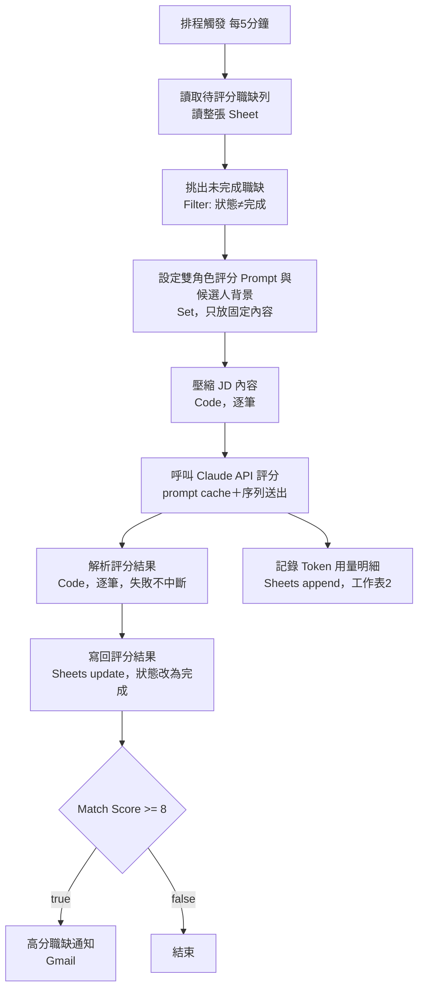

# AI 職缺評分自動化管線（n8n × Claude API）

一條自動運作的 n8n 工作流程：排程讀取 Google Sheet 裡的新職缺，用「雙角色」邏輯呼叫 Claude API 評估契合度，把分數、理由、風險寫回表格，高分職缺自動寄信通知。

> 個人專案（2026）。這份 repo 只放**去敏後**的 workflow 與文件：Google Sheet ID、email、憑證 ID 都已換成佔位文字，system prompt 裡的候選人背景也換成虛構範例。

---

## 為什麼做這個

找工作時，要看的職缺很多，逐筆閱讀、判斷契合度太花時間。我想要一個流程：**把職缺貼進表格就好，評分、理由、風險自動填回來，值得投的才通知我。**

## 成果

| 項目 | 結果 |
|------|------|
| 開發時間 | 從第一次接觸 n8n 到流程可運作，**不到 1.5 個工作天**（由 AI 產生底稿，我測試、回報問題，再依 AI 建議調整） |
| 評分量 | 累計評分約 **50 筆**職缺 |
| 省下的時間 | 人工判斷一筆約 10 分鐘 → 約 **8 小時**的人工初篩 |
| API 成本 | 找出 prompt cache 沒命中的原因並修正後，呼叫成本降低約 **二成** |
| 運作方式 | 每 5 分鐘自動執行，不需要人工介入 |

---

## 架構

| 節點 | 職責 |
|------|------|
| 排程觸發 | 每 5 分鐘啟動一次 |
| 讀取待評分職缺列 | 讀整張工作表（Google Sheets 節點的內建篩選不支援「不等於」，所以篩選放到下一步） |
| 挑出未完成職缺 | 只保留「狀態」不等於「完成」的列 |
| 設定雙角色評分 Prompt | 只放**每次都不變**的內容（評分規則＋候選人背景），讓 prompt cache 能命中 |
| 壓縮 JD 內容 | 規則式去除制式福利文字，只留含「具備、熟悉、經驗、資格、學歷」等關鍵字的句子，降低 token 量 |
| 呼叫 Claude API 評分 | system block 標記 `cache_control: ephemeral`；Batching 設為一次一筆 |
| 記錄 Token 用量明細 | 把每次呼叫的 input／output／cache token 數寫進工作表2，作為成本流水帳 |
| 解析評分結果 | 解析 Claude 回傳的 JSON；失敗時標記「需人工檢查」，不讓整條流程卡死 |
| 寫回評分結果 | 用 `row_number` 對應原列寫回，同時把狀態改成「完成」，避免重複評分、重複扣費 |
| 門檻判斷／通知 | 分數 ≥ 8 才寄信，信中附上強調重點和評分理由 |

---

## 設計重點

### 1. 雙角色評分，避免分數一面倒

同一個 prompt 裡安排兩個角色：

- **鼓勵型生涯教練**：找出契合點、可轉移的能力。
- **嚴格現實派招聘主管**：核對 JD 中標記「必備」的硬性條件，指出薪資、職務、產業的落差。

兩方意見綜合成單一 `match_score`（0–10）。另外寫死一條規則：**任何必備條件沒滿足，總分不得高於 6**，避免分數全部集中在 7–9。

### 2. 成本控制：JD 壓縮＋prompt cache

- JD 先用規則式壓縮，只送核心句進 API。
- 固定不變的評分規則和候選人背景放在 system block 並標記 cache；逐筆變動的職缺資訊放在 messages。第 2 筆起，固定部分走 cache 讀取價。

### 3. 冪等設計：同一筆職缺不會被重複評分

寫回結果時把「狀態」改成「完成」，下一輪排程讀到這一列時會被 Filter 擋掉。測試時確認過：3 筆資料進入 Filter，已完成的 2 筆被擋下，只有 1 筆送進 API。

---

## 除錯歷程（節錄）

完整紀錄見 [docs/除錯測試報告.md](docs/除錯測試報告.md)。共找出 8 個跨節點的隱藏問題，最有代表性的一個是：

### prompt cache 永遠沒命中

**現象**：Token 流水帳裡 `cache_read_input_tokens` 一直是 0。就算 system prompt 逐字相同、兩筆呼叫只差幾毫秒，也都是「兩次 cache 建立、零次讀取」。

**根因**：HTTP Request 節點收到多筆資料時，預設是**同時平行送出**。兩個請求幾乎同時抵達 API，雙方都看不到對方剛建立的 cache，於是各建一份。

**修法**：把 Batching 的「Items per Batch」設成 1，強制一筆一筆送。

**驗證**：同一輪連續三筆呼叫，第 1 筆 `cache_creation_input_tokens=1058`；第 2、3 筆變成 `cache_read_input_tokens=1058`，成功命中。也確認了不需要另外設定延遲，**重點是「不要平行送出」，不是「要等多久」**。

### 另一個值得一提的：評分內容失真

評分理由裡出現「把總年資當成單一程式語言年資」的錯誤描述。追查後發現，system prompt 的候選人背景還是當初的範例佔位文字，模型照抄了。修正時刻意把「總年資」和「特定技術的使用年期」**分開寫**，避免模型把不同時間維度混在一起。修正後，有一個職缺的分數從 8 降到 6，因為硬性條件與薪資等方面的落差被正確揭露了，這是評估品質的提升。

---

## 從除錯歸納的設計原則

詳見 [docs/操作交接文件.md](docs/操作交接文件.md) 第五節。

1. **明確優於隱含**：下游用 `$('節點名稱').item.json['欄位']` 點名引用上游，不打開「Include Other Input Fields」這種全域開關，讓資料依賴關係一眼看得出來。
2. **cache 邊界要刻意維護成逐字相同**：固定內容和逐筆內容用節點邊界分開。
3. **依賴 cache 時，送出順序必須明確設為序列**：不依賴平台的預設行為。
4. **operation 不同的節點，從零建立，不要複製再改**：避免底層 JSON 殘留看不見的舊設定。

---

## 如何使用

1. 在 n8n 匯入 [workflow/job-scoring-pipeline.json](workflow/job-scoring-pipeline.json)。
2. 建立 Google Sheet，欄位依照 [sheet-template/](sheet-template/) 的兩個 CSV 表頭（工作表1：職缺評分主表；工作表2：Token 用量明細）。
3. 設定憑證：
   - Google Sheets、Gmail：OAuth2。
   - Claude API：Header Auth，Header 名稱 `x-api-key`，值填你的 Anthropic API Key。
4. 把三個 Google Sheets 節點裡的 `YOUR_GOOGLE_SHEET_ID`，以及 Gmail 節點的 `your_email@example.com`，換成自己的。
5. 把「設定雙角色評分 Prompt」節點裡的**候選人背景**換成自己的真實背景。
6. 把職缺貼進工作表1（職稱、公司、薪資、JD內容），狀態留空，啟用 workflow。

## 已知限制

- JD 壓縮依賴中文關鍵字清單。全英文 JD，或不用這些字眼的格式會抓不到句子，退回取前 800 字。
- 分數 ≥ 8 時，「強調重點」偶爾是空的（模型遵循指令的機率性誤差，後續測試未再出現）。可以加一道程式防呆。
- 「必備條件」的判定範圍（例如寫在制式條件欄、沒有標示「必備」的學歷）還沒有明文寫進 prompt。

## 技術

n8n（Schedule Trigger、Google Sheets、Filter、Set、Code、HTTP Request、IF、Gmail）· Claude API（Messages API、prompt caching）· JavaScript · Google Sheets

---

作者：車孟華
