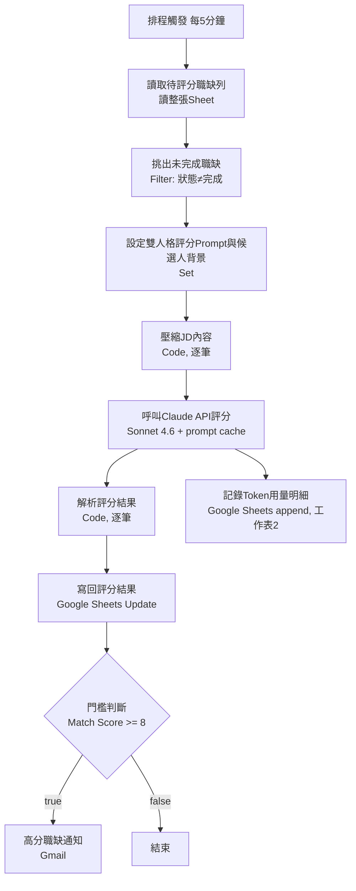

# n8n AI職缺評分管線 — 操作交接文件

**適用版本：** AI 職缺評分管線 (Job Scoring Pipeline)
**文件用途：** 給未來維護者（包含自己）快速理解架構、排除常見問題、評估改版影響範圍

---

## 一、系統架構

### 1.1 流程圖

### 1.2 各節點職責對照

| 節點 | 類型 | 職責 |
|---|---|---|
| 排程觸發 (每5分鐘) | Schedule Trigger | 每5分鐘啟動一次 |
| 讀取待評分職缺列 | Google Sheets (read) | 讀整張工作表，不在此節點篩選 |
| 挑出未完成職缺 | Filter | 只保留「狀態」欄不等於「完成」的列 |
| 設定雙人格評分Prompt與候選人背景 | Set | 產出固定不變的 `system_prompt`（雙人格規則＋候選人背景），供後面cache用 |
| 壓縮JD內容 (Token成本控制) | Code（逐筆） | 用規則式比對去除制式福利文字，保留含關鍵字的核心句，降低送進API的token量 |
| 呼叫Claude API評分 | HTTP Request | 呼叫Sonnet 4.6，system block標記`cache_control: ephemeral` |
| 記錄Token用量明細 | Google Sheets (append) | 從「呼叫Claude API評分」分支出來，與「解析評分結果」並行執行，不影響主流程；把該次Claude API回應的usage資訊（input/output/cache相關token數）逐筆寫入「工作表2」，作Token耗用流水帳 |
| 解析評分結果 | Code（逐筆） | 解析Claude回傳的JSON，解析失敗時不中斷流程，改標記為待人工複查 |
| 寫回評分結果 | Google Sheets (update) | 用`row_number`比對寫回對應列，同時把「狀態」改成「完成」 |
| 門檻判斷 (Match Score >= 8) | IF | 分流：>=8才繼續，否則靜默結束 |
| 高分職缺通知 | Gmail | 發送通知信 |

---

## 二、Google Sheet 欄位說明

### 2.1 工作表1（職缺評分主表）

| 欄位 | 性質 | 寫入節點 | 讀取/使用節點 | 備註 |
|---|---|---|---|---|
| 職稱 | 原始資料 | （人工填入） | 呼叫Claude API評分、記錄Token用量明細、高分職缺通知 | |
| 公司 | 原始資料 | （人工填入） | 呼叫Claude API評分、記錄Token用量明細、高分職缺通知 | |
| 薪資 | 原始資料 | （人工填入） | 呼叫Claude API評分、高分職缺通知 | |
| JD內容 | 原始資料 | （人工填入） | 壓縮JD內容 | |
| 狀態 | 原始＋系統回寫 | 寫回評分結果（固定寫入「完成」） | 挑出未完成職缺 | 初始值留空或非「完成」即可被撈到；跑完一次後系統自動改成「完成」，防止重複評分 |
| Match Score | 系統產出 | 寫回評分結果 ←`match_score` | 高分職缺通知 | 門檻判斷實際讀的是「解析評分結果」node的輸出，不是這個Sheet欄位 |
| Fit Note | 系統產出 | 寫回評分結果 ←`fit_notes` | 高分職缺通知 | |
| 強調重點 | 系統產出 | 寫回評分結果 ←`highlight_points` | 高分職缺通知 | Match Score>=8時才會有內容 |
| 風險標記 | 系統產出 | 寫回評分結果 ←`risk_flags` | （無下游節點讀取，僅供人工查看） | |
| 評分時間 | 系統產出 | 寫回評分結果 ←`$now` | （無下游節點讀取） | |
| row_number | n8n系統自動產生 | （不寫入Sheet本身） | 寫回評分結果（比對列用的matching key）、記錄Token用量明細（透過「參考列號」欄位引用，見2.2） | 來自讀取節點，非Sheet表頭欄位 |

### 2.2 工作表2（Token用量明細，v7新增）

從「呼叫Claude API評分」node分支出來，每次呼叫Claude API後append一筆紀錄，純流水帳、目前無任何下游節點讀取這張表。

| 欄位 | 性質 | 寫入node ←來源 | 備註 |
|---|---|---|---|
| 時間 | 系統產出 | 記錄Token用量明細 ←`$now` | |
| 職稱 | 複製自工作表1 | 記錄Token用量明細 ←`$('讀取待評分職缺列').item.json['職稱']` | |
| 公司 | 複製自工作表1 | 記錄Token用量明細 ←`$('讀取待評分職缺列').item.json['公司']` | |
| 參考列號 | 工作表1對應列號（外鍵） | 記錄Token用量明細 ←`$('讀取待評分職缺列').item.json.row_number` | v10新增。目的是讓這張流水帳能精確回溯對應工作表1的哪一列，避免「職稱＋公司」重複時無法辨識是哪一筆 |
| model | 系統產出 | 記錄Token用量明細 ←`$json.model`（Claude API回應本身的欄位） | |
| input_tokens | 系統產出 | 記錄Token用量明細 ←`$json.usage.input_tokens` | |
| output_tokens | 系統產出 | 記錄Token用量明細 ←`$json.usage.output_tokens` | |
| cache_creation_input_tokens | 系統產出 | 記錄Token用量明細 ←`$json.usage.cache_creation_input_tokens` | 欄名拼字已於v10修正（原為`cache_createion_input_tokens`），node mapping跟Sheet表頭文字同步改名，歷史資料保留在同一欄底下沒有跑掉 |
| cache_read_input_tokens | 系統產出 | 記錄Token用量明細 ←`$json.usage.cache_read_input_tokens` | 此欄長期為0的問題已於v9修正，根因與修法見五、原則三 |
| total_tokens | 系統產出（後端加總） | 記錄Token用量明細 ←四項token加總公式 | 公式（input+output+cache_creation??0+cache_read??0）已修正為正確加總；測試初期幾筆歷史資料是舊公式遺留，不影響目前版本 |

---

## 三、常見問題排除指南

| 症狀 | 可能原因 | 檢查/修復位置 |
|---|---|---|
| 篩選不到「狀態≠完成」的職缺，或又撈到已處理過的列 | Google Sheets節點內建篩選只支援「等於」比對，無法表達「不等於」 | 確認「挑出未完成職缺」Filter node存在且條件正確（狀態 notEquals 完成），不要又改回用讀取節點的filtersUI篩選 |
| JD壓縮結果長度恆為0（original_length: 0） | Code node引用的欄位key跟Sheet實際表頭文字不一致 | 比對「壓縮JD內容」node裡 `$('讀取待評分職缺列').item.json['JD內容']` 這個key，跟Sheet D欄表頭文字是否逐字相同（含有無空格） |
| 多筆職缺進去，卻只有1筆寫回結果，其他筆神秘消失 | Code node沒設定逐筆執行模式，預設用Run Once for All Items但程式碼寫的是單筆寫法 | 打開「解析評分結果」node，確認執行模式是 Run Once for Each Item |
| 通知信「強調重點」那段是空的 | 寫回節點的欄位mapping沒有對應到這個欄位，或被標記為removed | 打開「寫回評分結果」node，確認Mapping裡「強調重點」對應`{{ $json.highlight_points }}`，且該欄位未被移除 |
| 通知信主旨/內文有奇怪殘留文字或引用錯誤 | 編輯過程的殘留，或引用來源寫錯 | 直接打開「高分職缺通知」node，逐字檢查subject跟message裡的expression |
| 職稱/公司/薪資送進Claude API變成"undefined" | 「設定雙人格評分Prompt」Set node沒開Include Other Input Fields，下游若用裸`$json[...]`引用就抓不到原始欄位 | 確認「呼叫Claude API評分」node的jsonBody，職稱/公司/薪資是否用`$('讀取待評分職缺列').item.json[...]`直接點名引用，不要改回裸的`$json[...]` |
| node的Notes講的跟實際邏輯不一樣 | 改了邏輯但忘記同步更新文件 | 每次調整篩選／寫回核心邏輯後，回頭檢查「讀取待評分職缺列」「寫回評分結果」這兩個node的Notes是否還準確 |
| fit_note出現跟事實不符的背景描述（年資、技術年期等） | system_prompt裡的候選人背景還是範例佔位文字，沒被換成真實內容 | 打開「設定雙人格評分Prompt與候選人背景」node，確認【候選人背景】那段是真實內容，不是還寫著「請在此填入…」 |
| Token用量紀錄（工作表2）裡`cache_read_input_tokens`長期是0，即使是同一輪排程裡前後兩筆職缺、`時間`欄位只差幾毫秒（**此問題已於v9修正**，以下保留供未來迴歸排查參考） | 「呼叫Claude API評分」HTTP Request node收到多筆item時，預設是把所有item的請求一次性平行(concurrent)送出，不是序列等前一筆回應完成才送下一筆。Prompt Cache的「讀取」必須建立在前一筆已經完成寫入之後；兩筆請求幾乎同時抵達API時，雙方都只會看到「目前沒有現成cache」，於是各自重新建立一份，沒有人讀到對方的 | 打開「呼叫Claude API評分」node的Options，確認Batching底下「Items per Batch」是否仍為1（v9驗證過：單純設batchSize=1即可讓cache命中，不需要額外設Batch Interval）。可在n8n的Executions頁面點開該次執行，看這個node底下各item的時間軸是否「上下相疊」（平行，異常）或「前後相接」（序列，正常）來確認 |

---

## 四、Google Sheet欄位改名 / JD格式改變時，要去哪些節點調整

### 4.1 欄位改名

| 改名欄位 | 要同步修改的節點與位置 |
|---|---|
| 職稱 / 公司 / 薪資 | 「呼叫Claude API評分」node的jsonBody（3處點名引用）；「高分職缺通知」node的subject與message（共4處點名引用）；「記錄Token用量明細」node的Columns mapping（職稱、公司共2處點名引用，薪資未被引用） |
| JD內容 | 「壓縮JD內容」node裡的 `rawJD` 取值那一行（含旁邊的console.log那行，建議一併改掉避免混淆） |
| 狀態 | 「挑出未完成職缺」Filter node的條件欄位；「寫回評分結果」node的Mapping裡「狀態」這個key |
| Match Score | 「寫回評分結果」node的Mapping key；「高分職缺通知」node裡的 `$json['Match Score']`（共2處） |
| Fit Note | 「寫回評分結果」node的Mapping key；「高分職缺通知」node裡的 `$json['Fit Note']`（共2處） |
| 強調重點 | 「寫回評分結果」node的Mapping key；「高分職缺通知」node裡的 `$json['強調重點']`（共2處） |
| 風險標記 / 評分時間 | 只需改「寫回評分結果」node的Mapping key，沒有其他下游節點引用 |

### 4.2 JD格式改變

「壓縮JD內容」node目前用規則式（rule-based）邏輯壓縮，依賴兩個假設，JD格式改變時要回頭檢查：

1. **制式福利文字的去除規則**：寫死比對「公司簡介」開頭段落、以及「優於勞基法、員工旅遊、生日禮金、尾牙、不定期聚餐」這類關鍵字。如果職缺來源改成不會有這些套版文字的格式，這段regex不會造成問題（比對不到就不刪），但也不會有效果。
2. **保留核心句的關鍵字清單**：目前用「具備、熟悉、經驗、需求、資格、條件、歡迎、加分、證照、學歷」這幾個字去抓取JD裡的重點句。**如果JD來源換了一個完全不用這套字眼描述需求的格式**（例如全英文職缺、或用條列符號＋無這些字眼的簡短短句），這個關鍵字清單會抓不到任何句子，程式碼會fallback成直接取前800字，可能把套版開場白也壓縮進去，反而失去壓縮的意義——這種情況要回頭重新設計關鍵字清單或壓縮策略，不能假設舊清單通用。

---

## 五、n8n 流程設計原則（從本次除錯歷程歸納）

### 原則一：明確優於隱含（Explicit over Implicit）

修正「Set node砍欄位」這個問題時，存在兩種做法：打開Set node的「Include Other Input Fields」開關，或是在下游節點改成直接點名引用上游node。

兩種做法都能解決當下症狀，但風險不同：**「Include Other Input Fields」是節點層級的全域行為**——打開後，不管未來上游再接什麼欄位進來，全部會原樣往下傳，沒有任何地方明確列出「這個node實際帶了哪些欄位」。如果未來上游多加一個欄位，這個開關不會通知任何人，新欄位就會悄悄混進下游，等到某個下游節點意外收到不該有的欄位、出現難以追查的bug，才會被發現。

相對地，**下游用 `$('節點名稱').item.json['欄位名稱']` 直接點名引用**，雖然每處都要明確寫出依賴哪個欄位，程式碼看起來囉嗦，但任何人看code就能立刻知道這個節點真正依賴哪幾個欄位，未來上游加欄位也不會被誤帶。

**設計判斷：在「節省幾行設定」跟「讓資料依賴關係可被肉眼追蹤」之間，選擇後者。** 這不是隨口的風格偏好，是用維護成本去換debug成本的工程取捨。

### 原則二：cache邊界要刻意維護成bit-for-bit相同

Prompt caching（`cache_control: ephemeral`）只有在送進API的內容逐字相同時才會命中。本流程刻意把「設定雙人格評分Prompt與候選人背景」這個Set node的職責鎖死成**只能裝永遠不變的內容**——雙人格規則跟候選人背景，每一筆執行都完全一樣的文字。

這個設計決定直接導致了原則一的修法選擇：如果打開Include Other Input Fields，讓職稱/公司/薪資這些逐筆變動的職缺資訊也流進這個node、跟著system_prompt一起被往下傳，這個node的輸出就會每一筆都不同，等於親手拆掉了cache_control生效的前提，每一筆都會cache miss，白白付cache write的額外成本卻換不到任何省錢效果。

**設計判斷：把「每筆都不變的內容」跟「逐筆變動的內容」用節點邊界刻意分隔開，不讓任何逐筆資料汙染被標記為cache的那個區塊。** 這個邊界不是自然形成的，是設計者主動畫出來、並且用節點職責去鎖死的。

### 原則三：依賴Prompt Cache命中時，跨筆呼叫的送出順序必須刻意強制序列化

HTTP Request node收到多筆input item時，預設行為是把所有item的請求一次性平行(concurrent)送出，而不是一筆一筆等前一筆回應後才送下一筆。這個預設行為在一般情境下是效能優化（平行送出比序列等待快很多），但在本流程裡，因為「呼叫Claude API評分」node刻意對system_prompt標記了`cache_control: ephemeral`，期待同一輪執行裡的多筆職缺能共用同一份cache——只有第一筆要付cache write的全價，後面幾筆能用cache read的折扣價。這個設計假設了「前一筆的cache一定已經寫入完成，後一筆才送出」的時序關係。

但平行送出打破了這個假設：如果兩筆請求幾乎同時抵達Anthropic的API，兩邊都只會看到「目前沒有現成的cache可讀」，於是各自重新建立一份，沒有人讀到對方的。最初的實測結果（工作表2的Token紀錄）證實了這點：即使system_prompt逐字相同、即使兩筆呼叫只差幾毫秒，仍是「兩次cache_creation、零次cache_read」，完全沒有省到錢——等於白白多付了cache write的額外成本，卻拿不到任何cache read的折扣回報。

修法是在該node的Options裡加上Batching設定，強制n8n變成「送一筆→等回應→才送下一筆」的真序列模式，讓前一筆的cache寫入有時間真正完成，下一筆才有機會讀到。**此問題已於v9修正並驗證**：實際上線後的資料顯示，同一輪排程裡連續三筆呼叫，第1筆`cache_creation_input_tokens=1058`／`cache_read_input_tokens=0`（冷啟動寫入），第2、3筆則變成`cache_creation_input_tokens=0`／`cache_read_input_tokens=1058`（成功命中）。而且驗證過程中發現一個比預期更精簡的結果：只需要把Batching的「Items per Batch」設成1（強制一筆一筆送），不需要額外設定「Batch Interval」延遲毫秒數，cache依然能命中——代表cache的寫入幾乎是跟著API回應同步完成，重點在於「不要平行送出」，不在於「要等多久」。

**設計判斷：當下游商業邏輯（這裡是cache命中）隱含了對請求送出順序/時序的假設時，不能依賴node預設的平行行為去剛好滿足這個假設，必須用node本身的設定（Batching）把序列化這件事明確寫死，讓「一筆一筆來」變成一個可被檢視、不會因未來n8n版本更新或預設值改變而悄悄被打破的明確設定。** 這跟原則二是兩件不同的事：原則二保證「內容逐字相同」（cache命中的必要條件），原則三保證「送出順序正確」（cache命中的另一個必要條件）；內容相同但送出順序錯亂，一樣命中不了cache。

### 原則四：新增node時，從正確的operation/type建立優於複製既有node再大改

「記錄Token用量明細」這個node最早是用複製「寫回評分結果」（Google Sheets / Update operation）這個既有node的方式建立，再把operation改成Append。問題是：複製過去的設定不會因為改了operation就自動清空——n8n只是把UI上跟目前operation無關的欄位隱藏起來，底層JSON裡那些Update operation專屬的設定（像`matchingColumns: ["row_number"]`，本來是Update用來比對「要更新哪一列」的key）並不會被清掉，只是變成UI上看不到、也改不到的死資料，繼續留在node的JSON裡。Append這個operation根本不會用到matchingColumns，所以它不會造成任何執行錯誤，純粹是一塊解釋不出來源、也沒有介面可以清除的歷史殘留。

這跟原則一、二、三講的「節點邊界要刻意維護」是同一類問題，只是發生的位置不同：前三個原則講的是「資料」會不會悄悄夾帶不該有的東西，這裡講的是「node的設定本身」會不會因為複製而夾帶不該有的歷史設定。兩者的共通風險都是一樣的：看起來在跑、結果也正確，但底層帶著一塊看不見、講不出原因的殘留，等到有一天需要稽核或交接，會卡在「這個設定為什麼在這裡」這種沒人答得出來的問題上。

修法是把這個node直接刪掉重建：選正確的node type（Google Sheets）跟正確的operation（Append）從零開始設定mapping，而不是複製一個operation不同的既有node再修改。重建後實際確認過，`matchingColumns`欄位變成乾淨的空陣列`[]`，不再帶著Update operation的殘留。

**設計判斷：當新node的operation跟既有node不同時，複製既有node省下的設定時間，換來的可能是一塊永遠不會出現在UI上、卻一直留在JSON裡的不明殘留設定。遇到operation不同的情況，直接從零建立雖然要重新打一次mapping，但能保證node裡的每一個設定都是當前operation真的會用到的，沒有歷史包袱。**

### 四個原則的共通點

四個原則都指向同一件事：**一個節點該輸出什麼、不該輸出什麼、用什麼順序處理多筆item、以及node本身的設定裡實際存在哪些欄位，都是需要刻意決定並維護的設計邊界，不是讓系統（或複製貼上）用預設行為自動處理就好的細節。** 開關式的「全部通過」設定、讓平台自己決定平行或序列、或是複製一個現成node省事改一改，都能解決當下的症狀，但犧牲的是邊界的可預測性——資料層面或設定層面，都可能悄悄夾帶說不出原因的東西。本流程在四個地方都選擇了「寫死、明確、從零建立」的做法，代價是程式碼多幾行、設定多打幾次，換到的是未來改版或交接時，每一處設定都能被解釋、不會被隱性行為或歷史殘留干擾維護時效。
